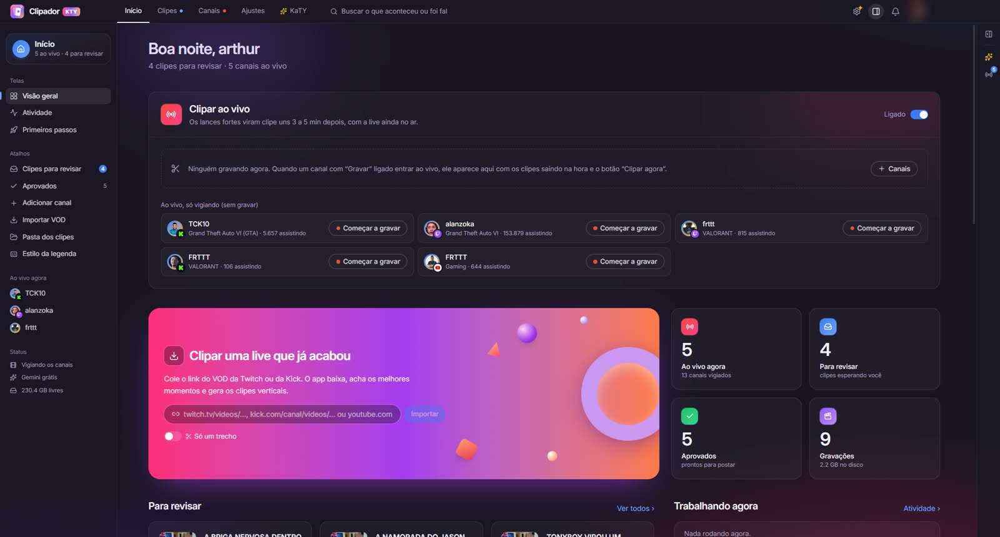
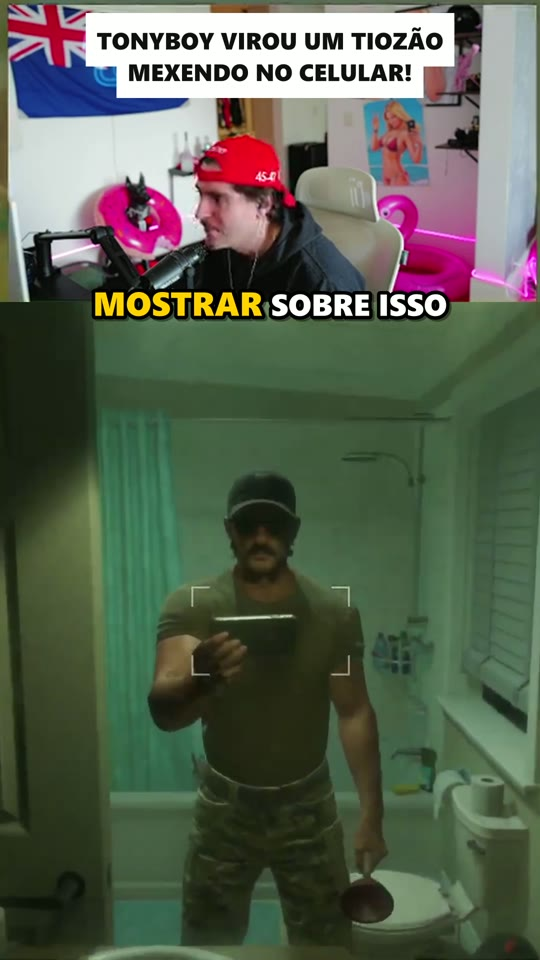
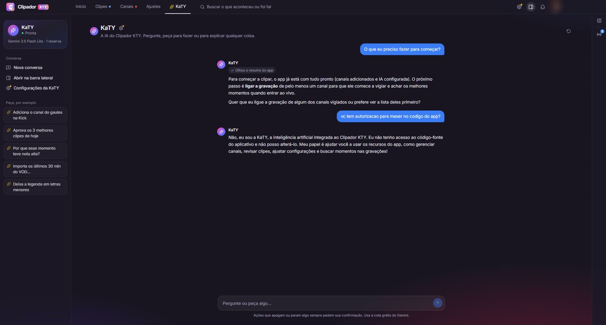
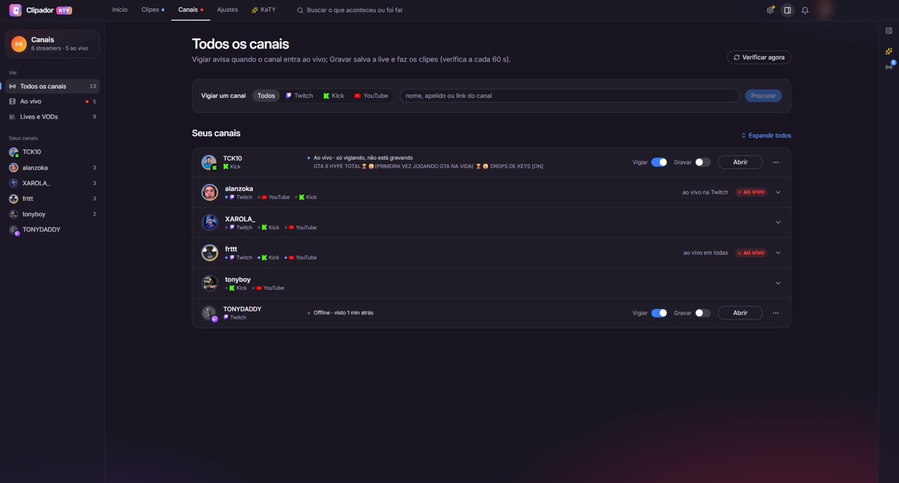
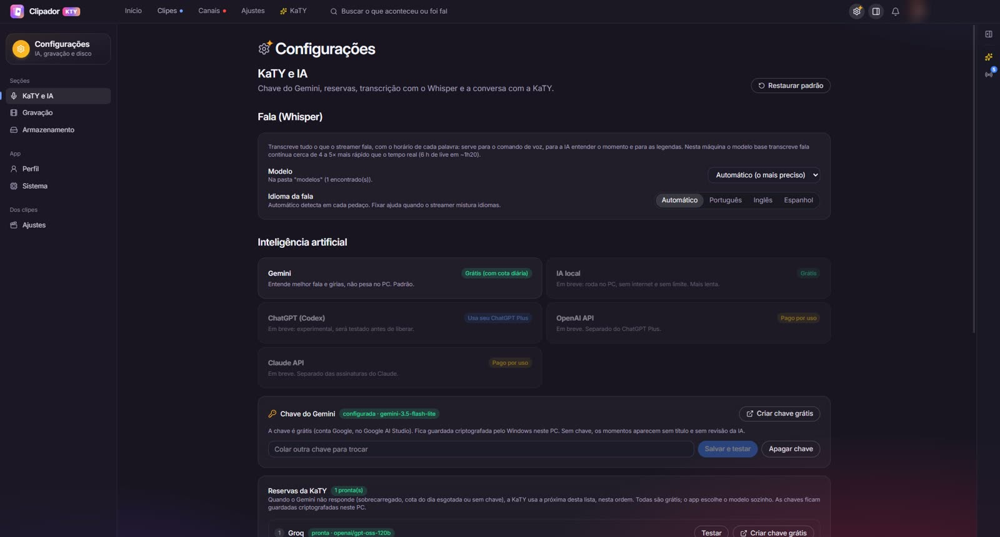

# Clipador KTY

Clipador automático com IA para lives da **Twitch**, da **Kick** e do **YouTube** (uso pessoal e de amigos).
Ele vigia os canais, grava as lives, acha os melhores momentos e gera clipes verticais prontos para o **YouTube Shorts** e o **TikTok**.
A IA do app se chama **KaTY**. O plano completo está em [PLANO.md](PLANO.md).



## O que ele faz

- **Vigia e grava**: avisa quando o canal entra ao vivo e grava na qualidade máxima (Streamlink na Twitch). Também importa VODs por link, inteiros ou só um trecho.
- **Acha os momentos**: picos de chat, áudio, fala transcrita pelo Whisper, pedido do streamer ("clipa isso") e clipes da comunidade.
- **KaTY revisa cada lance**:
  1. conta o que aconteceu;
  2. escolhe um começo que prende nos 3 primeiros segundos e um fim logo depois da reação;
  3. faz o teste do estranho (quem nunca viu o canal entende?);
  4. dá a nota por partes (gancho, desfecho, emoção, compartilhável);
  5. escreve título e hashtags no estilo dos cortes que viralizam.
- **Clipar ao vivo**: o clipe fica pronto alguns minutos depois do lance, com a live ainda no ar.
- **Clipes verticais**:
  - **Facecam + jogo**: a KaTY acha a câmera do streamer sozinha;
  - tela inteira, recorte do centro ou horizontal;
  - legenda palavra a palavra com fonte e cores à escolha;
  - título na tela;
  - volume no padrão das redes;
  - corte encaixado na fala e sem pausas longas.
- **Postagem**: pasta "para postar" com títulos, descrições e legendas prontos para YouTube Shorts e TikTok.
- **Reservas da KaTY**: se o Gemini não responder, a análise segue no Groq, OpenRouter, Mistral ou numa IA local (Ollama).
- **Converse com a KaTY**: ela explica e usa o app por você (adicionar canais, aprovar clipes, mudar ajustes); ações que apagam algo pedem confirmação.

## Prints

| Clipe gerado (Facecam + jogo) | KaTY |
|---|---|
|  |  |

| Canais | Configurações |
|---|---|
|  |  |

## Rodar em desenvolvimento

```bash
cd app
npm install
node node_modules/electron/install.js   # baixa o Electron na primeira vez
npm run dev
```

No Windows, dá para abrir com `Abrir Clipador (desenvolvimento).bat`.

## Programas

Coloque na pasta `programas/` (fora do git):

- `ffmpeg.exe`, `ffprobe.exe`, `yt-dlp.exe` (obrigatórios)
- `whisper/whisper-cli.exe` e DLLs (transcrição da fala)
- `streamlink/` (gravação da Twitch)

## IA

A KaTY usa o **Gemini** (chave grátis do Google AI Studio). As chaves são coladas no app, em Configurações > KaTY e IA, e ficam guardadas criptografadas pelo Windows, nunca no código. As reservas (Groq, OpenRouter, Mistral) também são opcionais e grátis.

## Comandos

| Comando | O que faz |
|---|---|
| `npm run dev` | Abre o app com recarga automática |
| `npm run build` | Gera `app/out` |
| `npm run typecheck` | Checa os tipos |
| `npm test` | Roda os testes |

## Dados

Em desenvolvimento, banco e arquivos ficam em `dados/` (fora do git). Gravações e clipes vão para a pasta escolhida em Configurações > Armazenamento.
